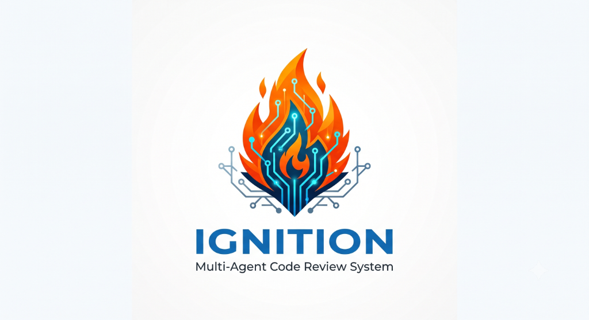
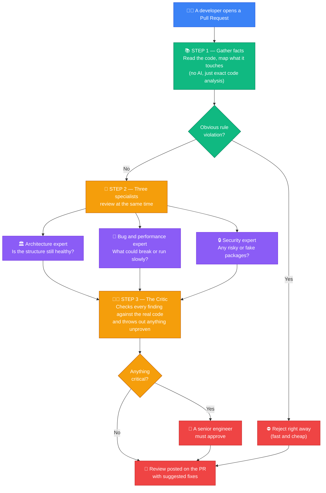
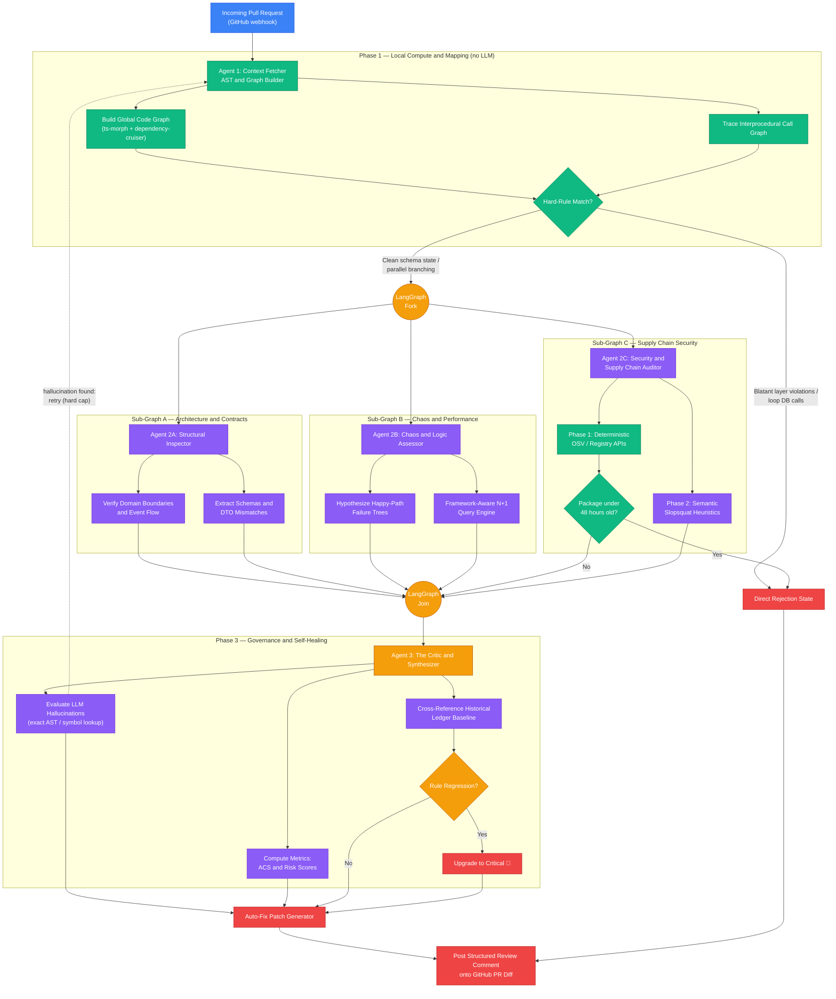

<div align="center">



# Ignition

**An autonomous, multi-agent AI code reviewer for TypeScript / JavaScript pull requests.**

*Deterministic code decides. AI explains. A critic double-checks everything before you see it.*

</div>

---

## Table of Contents

1. [What is Ignition?](#1-what-is-ignition)
2. [The problem it solves](#2-the-problem-it-solves)
3. [How it works, in plain English](#3-how-it-works-in-plain-english)
4. [The full flow diagram](#4-the-full-flow-diagram)
5. [Every part explained](#5-every-part-explained)
6. [Severity levels and the human-approval gate](#6-severity-levels-and-the-human-approval-gate)
7. [The dashboard](#7-the-dashboard)
8. [Tech stack](#8-tech-stack)
9. [Project structure](#9-project-structure)
10. [Getting started](#10-getting-started)
11. [Design decisions](#11-design-decisions)
12. [Scope and limitations](#12-scope-and-limitations)
13. [Roadmap](#13-roadmap)
14. [Success metrics](#14-success-metrics)
15. [Contributing and license](#15-contributing-and-license)

---

## 1. What is Ignition?

Ignition is a first-pass code reviewer that works automatically. When a developer opens or updates a pull request (PR) on GitHub, Ignition reads the change, investigates it with a team of specialized AI agents, checks its own findings for mistakes, and posts one organized review comment on the PR. It can also suggest ready-made fixes.

Think of it as a tireless junior reviewer who never gets bored, never skips the boring parts, and is forced to prove every claim before speaking.

## 2. The problem it solves

AI coding tools let developers write code faster than ever. Human review has not sped up, so review is now the bottleneck between "code written" and "code shipped".

The obvious fix is to paste the diff into one LLM and ask "review this". That fails in predictable ways:

| Failure | What happens |
|---|---|
| **Context dilution** | One model judging security, architecture and logic at once gives shallow, "happy path" feedback. |
| **Hallucinated findings** | The model says "this function is missing" without checking. Developers stop trusting the tool. |
| **Invisible cross-file breakage** | A field renamed from `userName` to `user_name` passes the linter but breaks other files that use it. |
| **Hidden performance killers** | An N+1 database query looks fine in isolation and only hurts under real load. |
| **Supply-chain risk** | AI-suggested packages may be fake names ("slopsquatting") or brand-new malicious uploads with no CVE yet. |
| **Unpredictable escalation** | Most tools use fuzzy "confidence" to decide when to call a human, so behavior is hard to audit. |

Ignition is built to avoid each of these.

## 3. How it works, in plain English

Here is the whole idea in one picture. Read it top to bottom.



The four principles behind this layout:

1. **Deterministic before semantic.** Cheap rule-based checks run first. They catch obvious problems before any AI is called, which saves money and reduces the chance of AI mistakes.
2. **Narrow specialists.** Each agent owns exactly one concern and works in parallel with the others.
3. **Verification before trust.** A Critic re-checks every finding against the actual codebase using exact lookups, not guesses.
4. **Predictable escalation.** Calling a human depends on a fixed severity label, not a fuzzy confidence number.

## 4. The full flow diagram

This is the detailed, technical version of the same flow. Colors match the stages: 🟦 input, 🟩 local analysis (no AI), 🟪 specialist agents, 🟧 coordination and critic, 🟥 outputs.



> **How to read it:** green boxes are plain code (no AI). Purple boxes use an LLM. Orange boxes coordinate the work. Red boxes are results or actions. The dotted arrow is the Critic's self-correction loop, which is limited to a fixed number of retries so it can never run forever.

## 5. Every part explained

### 5.1 The trigger: GitHub App and webhook

Ignition is installed on your repository as a **GitHub App** ("Ignition Reviewer"). Whenever a PR is opened or updated, GitHub sends a `pull_request` webhook (a small automatic message) to Ignition's backend. Nothing needs to be run by hand, and there is no IDE plugin.

### 5.2 The backend: FastAPI

A **FastAPI** server (Python) receives the webhook, starts the review pipeline, and streams live progress to the dashboard. It is asynchronous, so many PRs and dashboard viewers can be handled at once. Because the same process runs the graph and streams it, no extra message relay is needed.

### 5.3 The orchestrator: LangGraph

**LangGraph** is the traffic controller. It models the review as a *state machine*: a map of steps, where each step reads and updates a shared "state" object. LangGraph provides:

- **Fork**: split the work into three parallel sub-graphs.
- **Join**: wait for all three and merge results safely (using *reducers* so two agents never overwrite each other).
- **Loops with limits**: send work back for more context, but only up to a hard retry cap.

### 5.4 Phase 1 — Agent 1: Context Fetcher *(deterministic, no LLM)*

Agent 1 reads the PR and builds a precise map of the code, using no AI at all.

- **AST (Abstract Syntax Tree)** is the code's structure in a form a program can query exactly.
- It uses a small **Bun service running ts-morph**, which wraps the real TypeScript compiler. This gives true type resolution and cross-file import tracking, which a syntax-only parser cannot do.
- **dependency-cruiser** maps which files depend on which.
- It builds a **Global Code Graph** and traces the **Interprocedural Call Graph** (who calls whom, across files). This gives the "blast radius" of the change.
- The service stays running and caches each repo's project in memory, so repeat reviews are faster than starting from scratch.

Its output is a strict JSON graph, validated into a typed `ASTGraphState` (Pydantic) model that becomes the starting state of the whole pipeline.

#### The Hard-Rule gate

Right after mapping, Agent 1 runs a **Hard-Rule Match?** check. Blatant violations, such as banned imports, forbidden layer crossings, or a database call inside a loop, go straight to **Direct Rejection**. No LLM is ever called, so these cases are instant and free. Everything else continues.

### 5.5 Phase 2 — The three parallel specialists

After the gate, the review forks into three sub-graphs that run at the same time.

#### Sub-Graph A — Agent 2A: Structural Inspector *(LLM)*

Guards the architecture and contracts.

- **Verify Domain Boundaries & Event Flow**: checks that code stays within its intended layer or module.
- **Extract Schemas & DTO Mismatches**: finds silent API contract breaks, such as a renamed field that other files still expect under the old name.

#### Sub-Graph B — Agent 2B: Chaos & Logic Assessor *(LLM + static analyzers)*

Looks for what can go wrong at runtime.

- **Hypothesize Happy-Path Failure Trees**: asks "what if this input is empty, this call fails, or this value is null?" and traces the consequences.
- **Framework-Aware N+1 Query Engine**: detects the pattern where code runs one database query per item in a loop, a classic hidden slowdown.
- Findings are checked against static analyzers. Past incidents and decisions are retrieved with semantic search (RAG over pgvector) for context.

#### Sub-Graph C — Agent 2C: Security & Supply Chain Auditor *(hybrid)*

Protects against risky dependencies, in two phases.

- **Phase 1 — Deterministic OSV/Registry APIs**: looks up each new package in the OSV vulnerability database and the npm registry. This is exact data, not AI opinion.
- **"Package < 48 hours old?"**: a brand-new package is treated as suspicious because malicious uploads often have no CVE yet. This triggers direct rejection.
- **Phase 2 — Semantic Slopsquat Heuristics**: a lightweight LLM score for names that look like typos or AI-invented lookalikes of real packages ("slopsquatting").

### 5.6 Phase 3 — Agent 3: Critic & Synthesizer *(LLM + deterministic tools)*

All three sub-graphs meet at the **Join**, then Agent 3 takes over. This is what makes Ignition trustworthy.

- **Evaluate LLM Hallucinations**: re-checks every claim against the real codebase using **exact AST / symbol lookup**, not vector similarity. If a claim says "function `foo` is missing", the Critic literally looks for `foo`. Unverified claims are dropped.
- **Self-healing loop**: if a hallucination is found, the graph can go back to Agent 1 for more context. This is capped at a fixed retry limit, after which the item is flagged for a human instead of looping forever.
- **Compute Metrics: ACS & Risk Scores**: calculates the **Architecture Compliance Score**, `(Total Dependencies − Total Violations) / Total Dependencies × 100`, with an explicit guard so PRs with zero dependencies do not divide by zero.
- **Cross-Reference Historical Ledger Baseline**: compares this PR with the stored history in Supabase.
- **Rule Regression?**: if the PR reintroduces something previously fixed or worsens a baseline score, the finding is **upgraded to Critical 🔴**.
- **Severity enum**: the Critic outputs a structured severity label for each finding, which drives the human-approval gate.

### 5.7 Auto-Fix Patch Generator

Where possible, Ignition proposes a concrete fix instead of only describing the problem, such as a rewritten N+1 query or a corrected dependency version. Fixes from several agents are sequenced and checked for conflicts so two agents never patch the same lines into a broken diff.

### 5.8 The output: a structured PR comment

Using **PyGithub**, Ignition posts one organized comment on the PR, grouped by agent (**Architecture / Logic & Performance / Security**), with each finding tagged by severity and any suggested patch included. On merge, the PR's dependency graph and risk scores are written back to Supabase as the new baseline.

### 5.9 Memory: Supabase + pgvector

- **Architecture ledger**: history of past PRs, dependency graphs and risk scores, which makes regression detection possible.
- **Baseline scores**: what "normal" looks like for each repo.
- **Embeddings (pgvector)**: let Agent 2B find similar past incidents and decisions by meaning.

## 6. Severity levels and the human-approval gate

Ignition does **not** use a percentage "confidence score". A number like "87% sure" implies a measurement precision that does not exist. Instead, the Critic assigns a fixed severity tier to every finding, so the same class of issue always behaves the same way.

| Situation | What Ignition does |
|---|---|
| No Critical findings | Posts the review on the PR automatically. |
| Any **Critical** finding | **Pauses.** A senior engineer must explicitly approve before the review is finalized or any auto-fix is applied. |
| Retry cap reached on a suspected hallucination | Flags the item for a human instead of guessing. |

This is the **human-in-the-loop (HITL)** gate. Ignition never auto-merges when something Critical is found.

## 7. The dashboard

A **Next.js** control center that shows what the pipeline is doing:

- **Live execution view**: every state change is streamed over **Server-Sent Events (SSE)**, so you see which agents are running and what they have found so far, not a blank spinner.
- **Historical ledger**: past PRs, risk score trends and regression history.
- **Approval queue**: paused Critical reviews waiting for a human decision.

## 8. Tech stack

| Layer | Choice | Why |
|---|---|---|
| Orchestration | **LangGraph (Python)** | Mature ecosystem, checkpointing, and good fit with the Python backend. |
| Backend / API | **FastAPI** | Async webhooks and direct SSE streaming from the same process. |
| AST engine | **Bun + ts-morph + dependency-cruiser** | Real TypeScript compiler-level type resolution, run as a persistent warm service. |
| LLM | **Qwen3 family, hosted on Groq** | Used only where reasoning is needed (Agents 2A, 2B, 2C phase 2, and 3). Agent 1 and 2C phase 1 are pure code. |
| GitHub integration | **GitHub App, PyGithub / httpx** | Webhooks in, review comments out. |
| Storage | **Supabase (Postgres) + pgvector** | Ledger, baselines and embeddings in one place. |
| Embeddings | **sentence-transformers** | Semantic retrieval for the RAG layer. |
| Frontend | **Next.js (App Router), Tailwind, shadcn/ui** | Dashboard and control center. |
| Real-time | **SSE, FastAPI → Next.js** | No extra pub/sub layer required. |
| Hosting | **Vercel** (frontend) + **Docker on Railway/Render** (backend) | Long-running reviews need a container, not a short serverless function. |

## 9. Project structure

> Adjust to match your repository layout.

```text
Ignition/
├── ignition_backend/        # FastAPI app, LangGraph pipeline, agents
│   ├── agents/              # Agent 1, 2A, 2B, 2C, 3
│   ├── graph/               # LangGraph state, fork/join, reducers
│   ├── analyzer/            # Bun + ts-morph AST service
│   ├── migrations/          # Supabase SQL migrations
│   └── frontend/            # Next.js dashboard
├── docs/
│   ├── ARCHITECTURE.md      # Engineering whitepaper
│   └── assets/              # Logo and diagrams
└── README.md
```

## 10. Getting started

### Prerequisites

- Python 3.11+
- [Bun](https://bun.sh)
- Node.js 18+ (for the dashboard)
- A Supabase project (with pgvector enabled)
- A Groq API key
- A GitHub App (webhook secret, app ID, private key)

### Setup

```bash
# 1. Clone
git clone https://github.com/suchitchopade3110-arch/Ignition.git
cd Ignition/ignition_backend

# 2. Backend
python -m venv .venv
source .venv/bin/activate        # Windows: .venv\Scripts\activate
pip install -r requirements.txt

# 3. AST analyzer
cd analyzer && bun install && cd ..

# 4. Environment
cp .env.example .env             # then fill in the values below

# 5. Database: run every file in migrations/ in the Supabase SQL Editor, in order

# 6. Run
bun run analyzer/server.ts &     # start the AST service
uvicorn main:app --reload        # start the API

# 7. Dashboard
cd frontend && npm install && npm run dev
```

### Environment variables

| Variable | Purpose |
|---|---|
| `GROQ_API_KEY` | LLM access |
| `SUPABASE_URL`, `SUPABASE_SERVICE_KEY` | Database |
| `GITHUB_APP_ID`, `GITHUB_PRIVATE_KEY`, `GITHUB_WEBHOOK_SECRET` | GitHub App |
| `ALLOWED_ORIGINS` | CORS origins for the dashboard |

Point your GitHub App's webhook URL at `https://<your-host>/webhook`, subscribe it to **Pull request** events, and install it on a repository.

## 11. Design decisions

| Decision | Reason |
|---|---|
| **ts-morph over tree-sitter** | ts-morph resolves real types across files. tree-sitter only parses syntax. |
| **Python LangGraph over LangGraph.js** | The AST data already crosses a JSON boundary, so staying in one language gives no real benefit, and Python has a more mature ecosystem. |
| **Persistent Bun service, not one process per PR** | Starting a fresh ts-morph project every time repeats expensive work. A warm cache enables incremental analysis. |
| **Severity tiers, not confidence scores** | Predictable, auditable behavior. |
| **Exact lookup, not vector search, for fact-checking** | Similarity can be "close enough" and wrong. Exact lookup either finds the symbol or does not. |
| **Capped retry loop** | Self-correction without runaway cost. |
| **Supabase for everything** | Proportionate to the scale of the project. |

## 12. Scope and limitations

Out of scope for v1:

- Auto-merge without human approval on any Critical finding
- Languages other than TypeScript / JavaScript
- IDE plugins and pre-commit local runs (webhook-triggered only)
- Private or self-hosted package registries in the supply-chain auditor

Known open items:

- **Multi-tenant data isolation** across users and repositories is under active hardening and should be completed and verified before any shared deployment.
- **Patch-conflict resolution** between agents proposing fixes to the same lines.
- **Schema drift** between the TypeScript analyzer's JSON output and the Python `ASTGraphState` model. The plan is to generate one from the other and validate it in CI.

## 13. Roadmap

- [ ] Finish and verify multi-tenant isolation
- [ ] Authentication on all API routes; webhook idempotency
- [ ] Job queue (Arq + Redis) replacing in-memory streaming and background tasks
- [ ] Structured logging and real health checks
- [ ] Pinned dependencies and a CI pipeline gating the test suite
- [ ] Fine-tuned review model, once real feedback data exists
- [ ] Verification layer exposed as a service other AI coding agents can call

## 14. Success metrics

- **Latency**: review comment posted in under about 60 seconds for a typical PR.
- **Precision**: false-positive rate low enough to avoid reviewer fatigue.
- **Hallucination rate**: near-zero unverified claims reach the final comment.
- **Regression catch rate**: share of intentionally seeded architecture and security regressions caught against the baseline.

## 15. Contributing and license

Issues and pull requests are welcome. Please open an issue first to discuss larger changes.

License: add your chosen license here (for example MIT).

---

<div align="center">

**Ignition** — verification-first AI code review.

</div>
